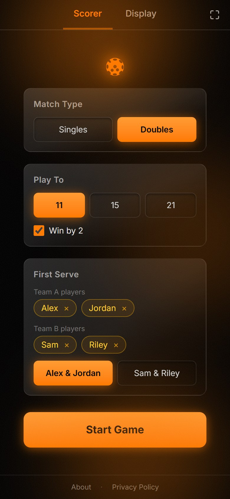
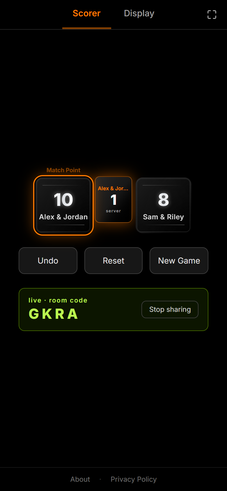
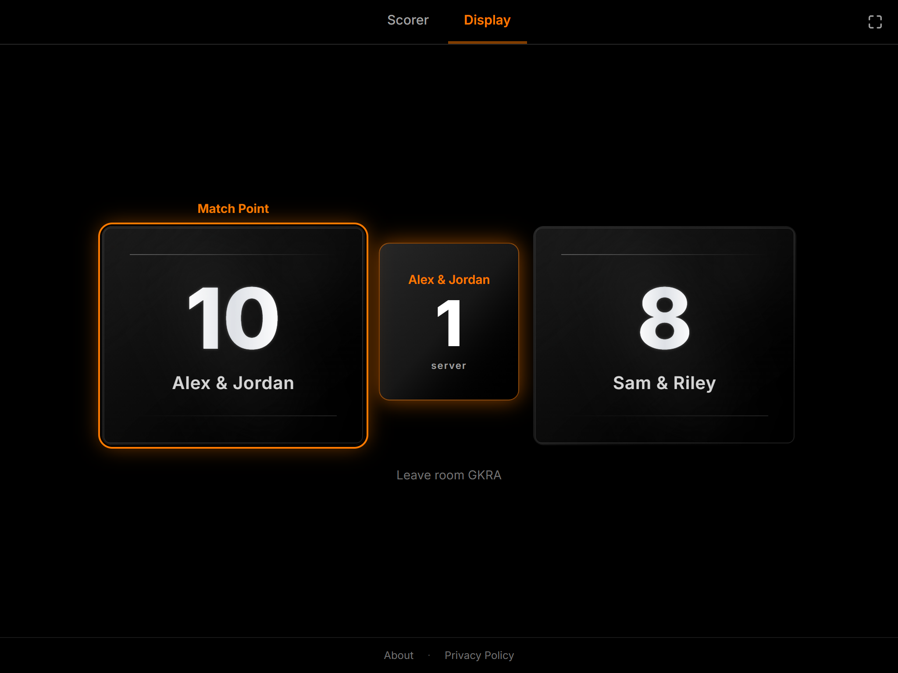

# PicklePoints

A simple pickleball scoreboard. Tap a point on your phone and it keeps the score and the serve for you, and a second device (like a tablet propped up courtside) can show the score live on a big screen.

  
  &nbsp;&nbsp;
  

  

## What it does

- **Keeps score and serve for you.** Follows traditional side-out scoring for singles and doubles, including server 1 / server 2 and the start-of-game exception, so nobody has to argue about whose serve it is.
- **Quick setup.** Singles or doubles, play to 11 / 15 / 21, win by 2 on or off, player names, and who serves first.
- **Built for the court.** Big tap targets, a "Match Point" flag, a winner banner, and Undo / Reset / New Game buttons.
- **Live second screen.** Hit **Go live** on the scoring phone to get a 4-letter room code. Open the **Display** tab on any other device, enter the code, and the score updates in real time. No accounts or sign-ups.

## How to use it

1. On the **Scorer** tab, set up the match and tap **Start Game**.
2. Tap the card of whichever team wins each rally.
3. Want a big scoreboard? Tap **Go live**, then on the tablet open **Display** and enter the room code.

> Live sync runs on Firebase. Copy `.env.example` to `.env` and add your own Firebase keys to turn it on. Everything else works without it.

## Why I made this

fun little project!

- got addicted to pickleball and was having a hard time keeping track of scoring.
- Wanted to integrate using two devices, one tablet for score, the other for scoring to make things easier!
